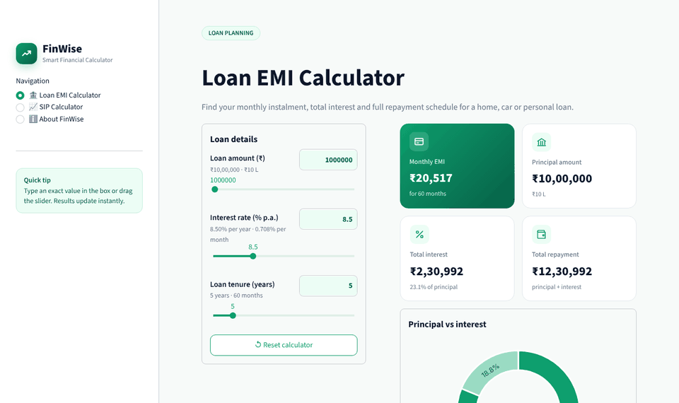
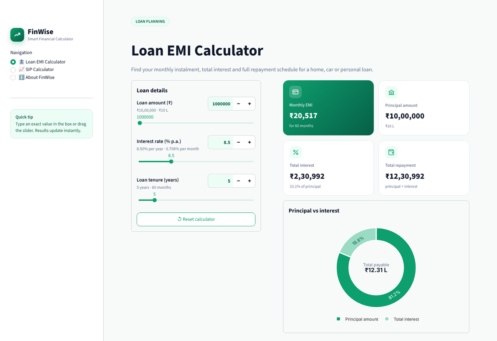
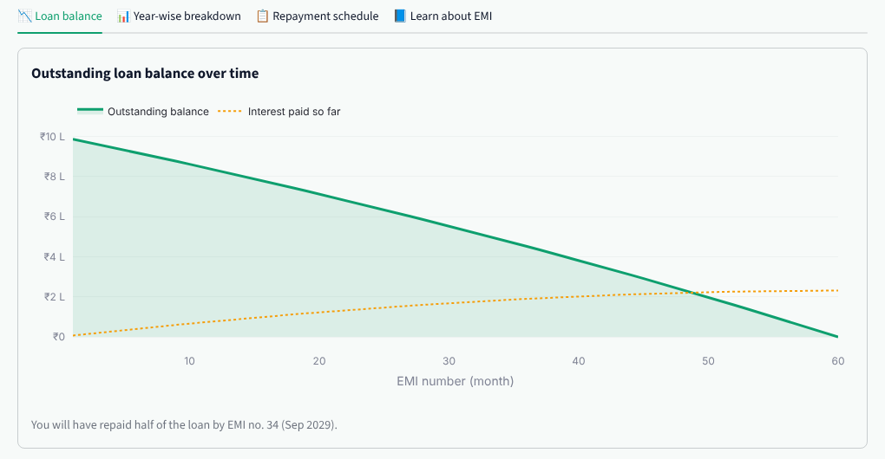
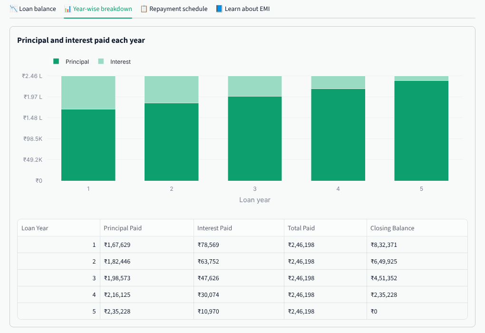
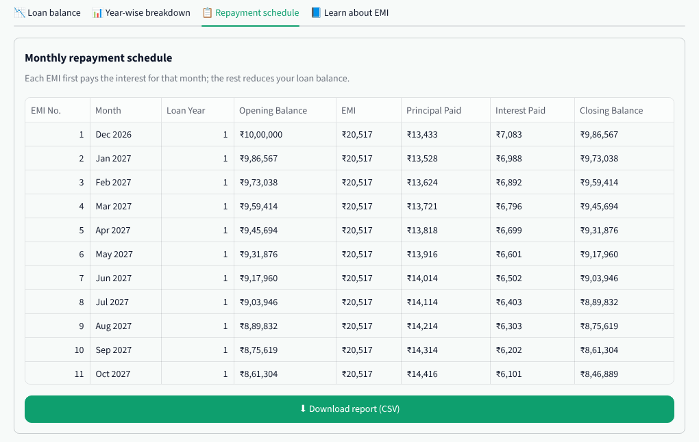
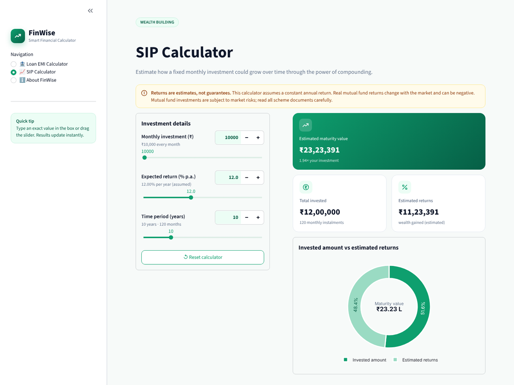
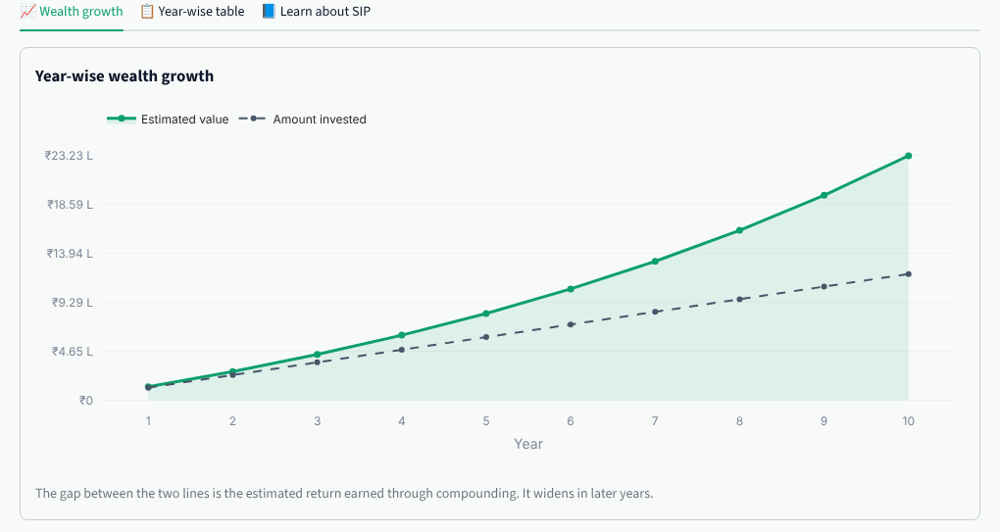
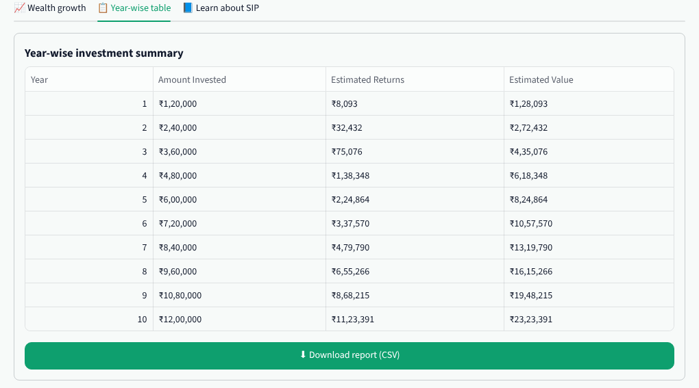
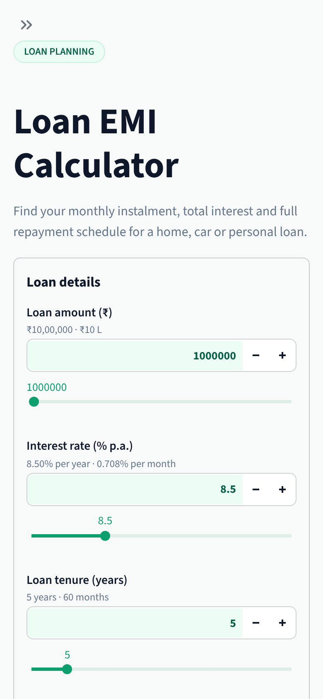

<div align="center">

# 💹 FinWise – Smart Financial Calculator

**A modern Loan EMI and SIP calculator built with Python, Streamlit and Plotly.**

[](https://www.python.org/)
[](https://streamlit.io/)
[](https://plotly.com/python/)
[](LICENSE)
[](#-quick-start-one-click)



*Every result, chart and table updates instantly as you change the inputs.*

</div>

---

## 📑 Contents

- [Features](#-features)
- [Screenshots](#-screenshots)
- [Quick start (one click)](#-quick-start-one-click)
- [Manual setup](#-manual-setup-optional)
- [How the calculations work](#how-the-calculations-work)
- [Sample values for testing](#-sample-values-for-testing)
- [Project structure](#-project-structure)
- [Troubleshooting](#-troubleshooting)
- [Viva questions](#-viva-questions)
- [License and disclaimer](#-license-and-disclaimer)

---

## ✨ Features

| 🏦 Loan EMI Calculator | 📈 SIP Calculator |
|---|---|
| Monthly EMI, total principal, total interest and total repayment | Total invested, estimated returns and estimated maturity value |
| Principal vs interest donut chart | Invested vs returns donut chart |
| Outstanding-balance chart with cumulative interest | Year-wise wealth growth line chart |
| Year-wise principal/interest bar chart and table | Year-wise investment table |
| Full month-by-month repayment schedule | Clear notice that returns are estimates, not guarantees |
| Handles 0% interest correctly | Handles 0% return correctly |

**Across the app**
- 🎚️ Every input has an **exact number box and a linked slider**
- ⚡ **Real-time** results with no "Calculate" button
- ₹ **Indian number formatting**: ₹12,34,567 and short forms such as ₹12.3 L and ₹1.2 Cr
- ⬇️ **CSV report download** that opens in Excel
- ↺ **Reset** button on each calculator
- 📘 A **"Learn" tab** on each calculator explaining the formula, with tips
- ✅ **Input validation** and warnings for unusual values
- 📱 **Responsive** green-and-white design with sidebar navigation that also works on phones
- 🖱️ **One-click launcher** for Windows, macOS and Linux

---

## 📸 Screenshots

### Loan EMI Calculator


| Outstanding balance | Year-wise breakdown |
|---|---|
|  |  |



### SIP Calculator


| Wealth growth | Year-wise table |
|---|---|
|  |  |

### On a phone


---

## 🚀 Quick start (one click)

**Step 1: get the project.** Either:
- click **Code → Download ZIP** on this page ([direct link](https://github.com/abhinavrenjithg-sys/finwise/archive/refs/heads/main.zip)) and unzip it, **or**
- clone it: `git clone https://github.com/abhinavrenjithg-sys/finwise.git`

**Step 2: start it.**

| System | What to do |
|---|---|
| 🪟 **Windows** | Double-click **`run.bat`** |
| 🍎 **macOS** | Double-click **`run.command`** (first time: right-click → **Open** → **Open**) |
| 🐧 **Linux** | Open a terminal in the folder and run **`bash run.sh`** |

That's it. The launcher will:

1. **Find Python 3.9+**. On Windows, if Python is missing, it installs Python 3.12 automatically with `winget`; otherwise it opens the download page.
2. **Create a private environment** (`.venv`) inside the project folder, so nothing else on the PC is changed.
3. **Install the packages** (first run only, about 1–3 minutes, needs internet).
4. **Pick a free port**, start FinWise and **open it in your browser**.

Later starts skip the setup and open in a few seconds. Keep the black terminal window open while you use the app. Close it, or press `Ctrl + C`, to stop.

> **First run on Windows:** if *"Windows protected your PC"* appears, click **More info → Run anyway**. This happens for any script downloaded from the internet.

---

## 🛠 Manual setup (optional)

If you prefer to run the commands yourself:

```bash
cd finwise
python -m venv .venv

# Windows
.venv\Scripts\activate
# macOS / Linux
source .venv/bin/activate

pip install -r requirements.txt
streamlit run app.py
```

Then open **http://localhost:8501**. In PyCharm, set the project interpreter to `.venv` and run `streamlit run app.py` in the built-in terminal.

---

<a id="how-the-calculations-work"></a>

## 🧮 How the calculations work

### EMI (Equated Monthly Instalment)

```
EMI = P × r × (1 + r)^n / ((1 + r)^n − 1)
```

| Symbol | Meaning |
|---|---|
| **P** | Loan amount |
| **r** | Monthly interest rate = annual rate ÷ 12 ÷ 100 |
| **n** | Number of monthly instalments = years × 12 |

- Total repayment = EMI × n, and total interest = total repayment − P
- **0% interest:** the formula would divide by zero, so FinWise uses EMI = P ÷ n
- **Repayment schedule (reducing balance), each month:** interest = opening balance × r; principal part = EMI − interest; closing balance = opening balance − principal part. The last instalment clears any rounding left over, so the loan ends at exactly ₹0.

### SIP (Systematic Investment Plan)

```
M = P × [((1 + i)^n − 1) / i] × (1 + i)
```

| Symbol | Meaning |
|---|---|
| **M** | Estimated maturity value |
| **P** | Monthly investment |
| **i** | Monthly return = expected annual return ÷ 12 ÷ 100 |
| **n** | Number of monthly instalments = years × 12 |

- Total invested = P × n, and estimated returns = M − total invested
- The extra **(1 + i)** is there because each instalment is invested at the **start** of the month
- **0% return:** M = P × n
- The year-wise chart evaluates the formula for every year at once using a **NumPy array**

> ⚠️ SIP figures assume a constant return. Real mutual fund returns vary with the market and **are not guaranteed**.

---

## 🧪 Sample values for testing

You can check the app against these values. They come from the app's own functions.

**Loan EMI**

| Loan amount | Rate | Tenure | Monthly EMI | Total interest | Total repayment |
|---|---|---|---|---|---|
| ₹10,00,000 | 8.5% | 5 years | **₹20,517** | ₹2,30,992 | ₹12,30,992 |
| ₹50,00,000 | 9% | 20 years | **₹44,986** | ₹57,96,711 | ₹1,07,96,711 |
| ₹5,00,000 | 11% | 3 years | **₹16,369** | ₹89,297 | ₹5,89,297 |
| ₹1,20,000 | 0% | 1 year | **₹10,000** | ₹0 | ₹1,20,000 |

**SIP**

| Monthly SIP | Return | Duration | Invested | Est. returns | Maturity value |
|---|---|---|---|---|---|
| ₹10,000 | 12% | 10 years | ₹12,00,000 | ₹11,23,391 | **₹23,23,391** |
| ₹5,000 | 12% | 20 years | ₹12,00,000 | ₹37,95,740 | **₹49,95,740** |
| ₹5,000 | 0% | 5 years | ₹3,00,000 | ₹0 | **₹3,00,000** |

<details>
<summary><b>Worked examples (click to expand)</b></summary>

**EMI: ₹10,00,000 at 8.5% for 5 years**
- r = 8.5 ÷ 12 ÷ 100 = 0.0070833, n = 60
- (1 + r)^60 ≈ 1.52730
- EMI = 10,00,000 × 0.0070833 × 1.52730 ÷ 0.52730 ≈ **₹20,516.53**
- Month 1: interest ₹7,083, principal ₹13,433

**SIP: ₹10,000 a month at 12% for 10 years**
- i = 0.01, n = 120, (1.01)^120 ≈ 3.30039
- M = 10,000 × (2.30039 ÷ 0.01) × 1.01 ≈ **₹23,23,391**

The two SIP rows both invest ₹12 lakh in total, but the 20-year plan ends with more than twice as much. That gap comes from compounding.
</details>

---

## 📁 Project structure

```
finwise/
├── app.py               # The whole Streamlit app (logic + UI), in 7 commented sections
├── launcher.py          # One-click setup and start (standard library only)
├── run.bat              # Windows: double-click to start
├── run.command          # macOS: double-click to start
├── run.sh               # Linux/macOS: bash run.sh
├── requirements.txt     # streamlit, plotly, numpy, pandas
├── .streamlit/
│   └── config.toml      # Green light theme, clean toolbar
├── docs/
│   ├── VIVA.md          # 22 viva questions with answers
│   └── screenshots/     # Images used in this README
├── LICENSE              # MIT
└── README.md
```

**Inside `app.py`**

| Section | Contents |
|---|---|
| 1. Page configuration | Page setup, colour palette, SVG icons, custom CSS |
| 2. Helpers | `format_inr`, `format_inr_short`, `build_csv_report` |
| 3. Calculation logic | `calculate_emi`, `build_amortization_schedule`, `yearly_loan_summary`, `calculate_sip`, `sip_yearly_growth` |
| 4. Charts | `donut_chart`, `loan_balance_chart`, `loan_yearly_bar_chart`, `sip_growth_chart` |
| 5. UI components | `input_with_slider`, `metric_cards`, `notice`, `reset_inputs` |
| 6. Pages | `emi_page`, `sip_page`, `about_page` |
| 7. Main | `sidebar`, `footer`, `main` |

The calculation functions don't depend on Streamlit, so you can import and test them on their own:

```python
from app import calculate_emi, calculate_sip
print(round(calculate_emi(1_000_000, 8.5, 5)["emi"]))       # 20517
print(round(calculate_sip(10_000, 12, 10)["maturity"]))     # 2323391
```

---

## 🩺 Troubleshooting

| Problem | Fix |
|---|---|
| *"Windows protected your PC"* | Click **More info → Run anyway** |
| macOS: *"cannot be opened because it is from an unidentified developer"* | Right-click `run.command` → **Open** → **Open**, or run `bash run.sh` in Terminal |
| *"Python 3.9+ was not found"* | Install Python from [python.org](https://www.python.org/downloads/) and tick **"Add python.exe to PATH"**, then run the launcher again |
| Linux: *"Could not create the virtual environment"* | `sudo apt install python3-venv python3-pip`, then `bash run.sh` again |
| *"Package installation failed"* | Check your internet connection. On a college/office network, set the `HTTPS_PROXY` environment variable. Then run the launcher again |
| The app stopped working after the folder was moved | Delete the `.venv` folder and start again; the launcher rebuilds it |
| The browser didn't open | Open the address shown in the terminal window (e.g. `http://localhost:8501`) |
| `streamlit` is not recognised (manual setup) | Activate `.venv` first, or use `python -m streamlit run app.py` |
| `python app.py` shows warnings and no page | Streamlit apps start with `streamlit run app.py`, or use the launcher |
| Port 8501 is already in use | The launcher picks the next free port automatically. Manually: `streamlit run app.py --server.port 8502` |

---

## 🎓 Viva questions

22 likely viva questions with answers (formulas, Streamlit, session state, NumPy, validation, the launcher, and more) are in **[docs/VIVA.md](docs/VIVA.md)**.

---

## 📄 License and disclaimer

Released under the [MIT License](LICENSE). © 2026 Abhinav.

FinWise is an **educational project** and does **not** give financial advice. Actual EMIs depend on your lender's terms and fees, and investment returns are **not guaranteed**. FinWise is independent and not affiliated with any bank, broker or investment platform.

<div align="center"><sub>Built with Python 🐍 · Streamlit · Plotly · NumPy · pandas</sub></div>
