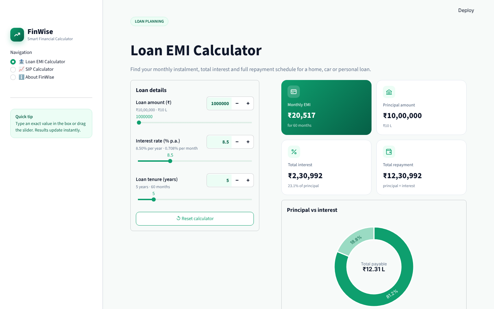
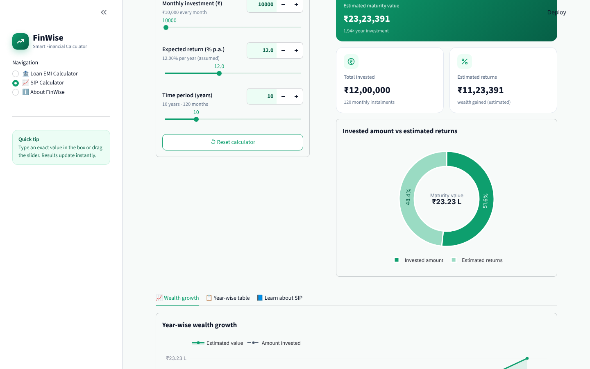

# FinWise – Smart Financial Calculator

A modern FinTech web app with a **Loan EMI Calculator** and a **SIP Calculator**, built in Python with Streamlit, Plotly, NumPy and pandas.




> Educational project. Results are illustrations only and not financial advice. SIP returns are estimates and are **not guaranteed**.

---

## 1. Features

### Loan EMI Calculator
- Loan amount, annual interest rate and tenure (years), each with an **exact number box and a linked slider**
- Monthly EMI, total principal, total interest, total repayment
- Principal vs interest **donut chart**
- **Outstanding loan balance** chart (plus cumulative interest paid)
- **Year-wise breakdown** stacked bar chart and table
- Full **month-by-month repayment schedule**
- **CSV report download** with the summary and the full schedule
- Handles **0% interest** (EMI = principal ÷ months)

### SIP Calculator
- Monthly investment, expected annual return and duration, each with an exact box and slider
- Total invested, estimated returns, estimated maturity value
- Invested vs returns **donut chart**
- **Year-wise wealth growth** line chart and table
- **CSV report download**
- Clear notice that returns are **estimates, not guaranteed**

### General
- Sidebar navigation (EMI / SIP / About)
- Results update **in real time** as you type or drag
- **Indian Rupee formatting**: ₹12,34,567 and short forms (₹12.35 L, ₹1.2 Cr)
- Input validation and warnings for unusual values
- **Reset** button on each calculator
- "Learn" tab on each calculator explaining the formula and giving tips
- Green and white theme, rounded cards, custom icons, responsive layout, professional footer

---

## 2. Project structure

```
finwise/
├── app.py                 # Whole application (logic + UI), split into clear sections
├── requirements.txt       # Python packages
├── README.md              # This file
└── .streamlit/
    └── config.toml        # Optional: green theme and forced light mode
```

`app.py` is organised into 7 sections:

| Section | What it contains |
|---|---|
| 1. Page configuration | `st.set_page_config`, colour palette, icons, CSS |
| 2. Helpers | `format_inr`, `format_inr_short`, `build_csv_report` |
| 3. Calculation logic | `calculate_emi`, `build_amortization_schedule`, `yearly_loan_summary`, `calculate_sip`, `sip_yearly_growth` |
| 4. Charts | `donut_chart`, `loan_balance_chart`, `loan_yearly_bar_chart`, `sip_growth_chart` |
| 5. UI components | `input_with_slider`, `metric_cards`, `notice`, `reset_inputs` |
| 6. Pages | `emi_page`, `sip_page`, `about_page` |
| 7. Main | `sidebar`, `footer`, `main` |

The calculation functions don't use Streamlit, so you can import them and test them on their own.

---

## 3. Installation

**Requirements:** Python 3.9 or newer (tested on Python 3.13 with Streamlit 1.67, Plotly 7.1, NumPy 2.5, pandas 3.0).

```bash
# 1. Go to the project folder
cd finwise

# 2. Create a virtual environment (recommended)
python -m venv venv

# 3. Activate it
#    Windows (Command Prompt / PowerShell):
venv\Scripts\activate
#    macOS / Linux:
source venv/bin/activate

# 4. Install the packages
pip install -r requirements.txt
```

---

## 4. Running the app

```bash
streamlit run app.py
```

1. Streamlit prints a local URL, usually **http://localhost:8501**, and opens it in your browser.
2. Pick **Loan EMI Calculator** or **SIP Calculator** in the sidebar.
3. Type a value in a box or drag a slider. The results, charts and tables update straight away.
4. Open the tabs under the results to see the balance chart, the year-wise breakdown, the full schedule and the explanations.
5. Click **Download report (CSV)** to save the calculation. It opens in Excel.
6. Click **Reset calculator** to go back to the default values.
7. To stop the server, press **Ctrl + C** in the terminal.

Use a different port with: `streamlit run app.py --server.port 8502`

---

## 5. Formulas

### 5.1 EMI (Equated Monthly Instalment)

```
EMI = P × r × (1 + r)^n / ((1 + r)^n − 1)
```

| Symbol | Meaning |
|---|---|
| P | Loan amount (principal) |
| r | Monthly interest rate = annual rate ÷ 12 ÷ 100 |
| n | Number of monthly instalments = years × 12 |

- Total repayment = EMI × n
- Total interest = Total repayment − P
- **Zero interest:** the formula divides by zero, so the app uses `EMI = P / n`.

**Repayment schedule (reducing balance):** every month
```
Interest for the month = Opening balance × r
Principal part         = EMI − Interest
Closing balance        = Opening balance − Principal part
```
At the start, most of the EMI goes to interest. Over time more of it goes to principal. In the last month the principal part is set to the remaining balance, so the loan ends at exactly ₹0.

### 5.2 SIP (Systematic Investment Plan)

```
M = P × [((1 + i)^n − 1) / i] × (1 + i)
```

| Symbol | Meaning |
|---|---|
| M | Estimated maturity value |
| P | Monthly investment |
| i | Monthly return = expected annual return ÷ 12 ÷ 100 |
| n | Number of monthly instalments = years × 12 |

- Total invested = P × n
- Estimated returns = M − Total invested
- The extra `(1 + i)` assumes each instalment is invested at the **start** of the month (an annuity due). This is the convention most Indian SIP calculators use.
- **Zero return:** `M = P × n`.
- The year-wise chart evaluates this formula for n = 12, 24, 36, ... in one step using a **NumPy array**.

---

## 6. Sample calculations for testing

These are the values the app shows. They were checked by running the functions.

### Loan EMI

| Loan amount | Rate | Tenure | Monthly EMI | Total interest | Total repayment |
|---|---|---|---|---|---|
| ₹10,00,000 | 8.5% | 5 years | **₹20,517** | ₹2,30,992 | ₹12,30,992 |
| ₹50,00,000 | 9% | 20 years | **₹44,986** | ₹57,96,711 | ₹1,07,96,711 |
| ₹5,00,000 | 11% | 3 years | **₹16,369** | ₹89,297 | ₹5,89,297 |
| ₹1,20,000 | 0% | 1 year | **₹10,000** | ₹0 | ₹1,20,000 |

Worked example (₹10,00,000, 8.5%, 5 years):
- r = 8.5 / 12 / 100 = 0.0070833, n = 60
- (1 + r)^60 ≈ 1.52730
- EMI = 10,00,000 × 0.0070833 × 1.52730 / 0.52730 ≈ **₹20,516.53**
- Month 1 interest = 10,00,000 × 0.0070833 = ₹7,083; principal = ₹13,433

### SIP

| Monthly SIP | Return | Duration | Invested | Est. returns | Maturity value |
|---|---|---|---|---|---|
| ₹10,000 | 12% | 10 years | ₹12,00,000 | ₹11,23,391 | **₹23,23,391** |
| ₹5,000 | 12% | 20 years | ₹12,00,000 | ₹37,95,740 | **₹49,95,740** |
| ₹5,000 | 0% | 5 years | ₹3,00,000 | ₹0 | **₹3,00,000** |

Worked example (₹10,000, 12%, 10 years):
- i = 12 / 12 / 100 = 0.01, n = 120
- (1.01)^120 ≈ 3.30039
- M = 10,000 × (2.30039 / 0.01) × 1.01 ≈ **₹23,23,391**

The two SIP rows invest the same ₹12 lakh, but over 20 years the maturity value is more than double. That shows how much time adds through compounding.

---

## 7. Common errors and solutions

| Error / problem | Cause | Solution |
|---|---|---|
| `'streamlit' is not recognized` / `command not found: streamlit` | Streamlit not installed, or venv not active | Activate the venv and run `pip install -r requirements.txt`, or use `python -m streamlit run app.py` |
| `ModuleNotFoundError: No module named 'plotly'` | Packages missing in the active Python | `pip install -r requirements.txt` in the same environment |
| `TypeError: ... unexpected keyword argument 'width'` or `'border'` | Old Streamlit version | `pip install --upgrade streamlit` (1.50 or newer) |
| `Port 8501 is already in use` | Another Streamlit app is running | Close it, or run `streamlit run app.py --server.port 8502` |
| `ZeroDivisionError` in your own EMI/SIP code | 0% rate makes the denominator 0 | Already handled: the app uses P/n for EMI and P×n for SIP |
| Running `python app.py` shows warnings and no page | Streamlit apps must run through Streamlit | Use `streamlit run app.py` |
| App looks dark / cards look odd | Browser or OS in dark mode | Keep `.streamlit/config.toml` (it forces the light theme), or choose *Settings → Theme → Light* in the app menu |
| Font looks different | No internet, so the Google font cannot load | Harmless: the app falls back to system fonts |
| CSV shows strange characters in Excel | Encoding | The file is saved as UTF-8 with BOM, so Excel should read it correctly. If it doesn't, use *Data → From Text/CSV* and choose UTF-8 |
| `pip` permission error | Installing into system Python | Use a virtual environment (see Installation) |

---

## 8. Viva questions and answers

**Q1. What is the purpose of this project?**
FinWise helps users plan loans and investments. It calculates the monthly EMI and total interest for a loan, and the estimated future value of a SIP, with charts, schedules and downloadable reports.

**Q2. Why did you choose Streamlit?**
Streamlit turns a Python script into a web app without HTML/JavaScript frameworks. It has ready-made widgets (sliders, number inputs, tabs, download buttons) and reruns the script whenever an input changes, which gives real-time results.

**Q3. How does real-time calculation work?**
Every widget change makes Streamlit rerun `app.py` from top to bottom with the new values. The calculation functions run again and the page redraws.

**Q4. What is session state and why is it used?**
`st.session_state` is a dictionary that keeps values between reruns. FinWise uses it to keep the number box and slider in sync, to remember inputs when you switch pages, and to restore defaults when you press Reset.

**Q5. Explain the EMI formula.**
EMI = P × r × (1+r)^n / ((1+r)^n − 1), where P is the principal, r the monthly rate and n the number of months. It gives the fixed payment that clears both principal and interest in exactly n months.

**Q6. Why do we divide the annual rate by 12 and by 100?**
EMIs are monthly, so the rate must be per month (÷12). The rate is entered as a percentage, so ÷100 turns it into a decimal (8.5% → 0.085).

**Q7. What happens if the interest rate is 0?**
The denominator (1+r)^n − 1 becomes 0, which would cause a division-by-zero error. The code checks for this and uses EMI = P / n.

**Q8. What is an amortization schedule?**
A month-by-month table of each EMI split into interest and principal, with the opening and closing balance. It shows how the loan reduces over time.

**Q9. Why is the interest part higher in the early months?**
Interest is charged on the outstanding balance. The balance is highest at the start, so interest is highest then. As the balance falls, interest falls and more of the EMI goes to principal.

**Q10. What is a SIP?**
A Systematic Investment Plan is a way to invest a fixed amount in a mutual fund at regular intervals, usually monthly.

**Q11. Explain the SIP formula.**
M = P × [((1+i)^n − 1)/i] × (1+i). The bracket is the future value of a series of equal monthly payments. The extra (1+i) is there because each payment is made at the start of the month and earns one more month of return.

**Q12. Are SIP returns guaranteed?**
No. The calculator assumes a constant return to give an estimate. Real mutual fund returns depend on the market and can be lower or even negative. The app shows this warning clearly.

**Q13. What is compounding?**
Earning returns on earlier returns, not just on the original amount. That's why the gap between the invested and value lines on the SIP chart widens over time.

**Q14. Where did you use NumPy?**
In `sip_yearly_growth`, `np.arange` creates all the year numbers and the SIP formula runs on the whole array at once (vectorisation), with no loop. NumPy also creates the tick positions for the chart axes.

**Q15. Why Plotly instead of Matplotlib?**
Plotly charts are interactive: they have hover tooltips and zoom, and they look modern in a web app. Matplotlib produces static images.

**Q16. How does Indian Rupee formatting work?**
The Indian system keeps the last three digits together and then groups by twos (12,34,567). `format_inr` splits the number into the last three digits and the rest, groups the rest in pairs, and adds the ₹ sign.

**Q17. How is the CSV report generated?**
`build_csv_report` uses Python's `csv` module and pandas `to_csv` to write a summary block and the full table into an in-memory buffer (`io.StringIO`). `st.download_button` then serves it, so no file is saved on the server.

**Q18. What validation have you done?**
The inputs have minimum and maximum limits, so negative or empty values can't be entered. The calculation functions also raise errors for invalid values, and the app shows warnings for unusual values like interest above 20% or returns above 15%.

**Q19. What is the difference between flat and reducing-balance interest?**
Flat interest is charged on the original principal for the whole tenure. Reducing-balance interest is charged only on the outstanding amount. FinWise uses reducing balance, which is how most bank loans in India work.

**Q20. How can this project be extended?**
Add a step-up SIP, lumpsum and SWP calculators, loan prepayment simulation, comparison of two loans, PDF reports, inflation-adjusted values, user login to save plans, or deployment on Streamlit Community Cloud.

---

## 9. Disclaimer

FinWise is for educational purposes only. It does not give financial advice. Actual EMIs depend on your lender's terms and fees. Investment returns are not guaranteed. FinWise is an independent project and is not affiliated with any bank, broker or investment platform.
